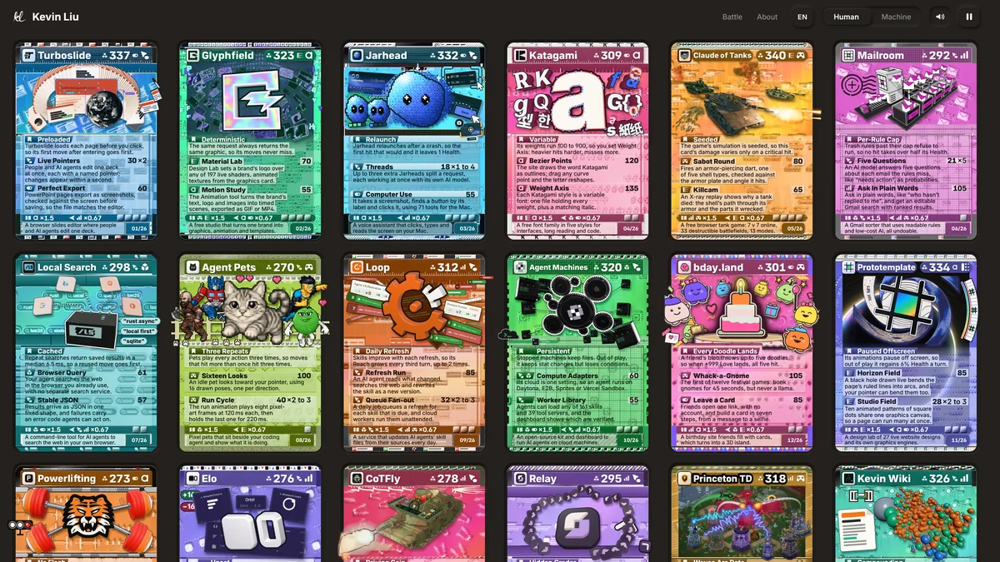
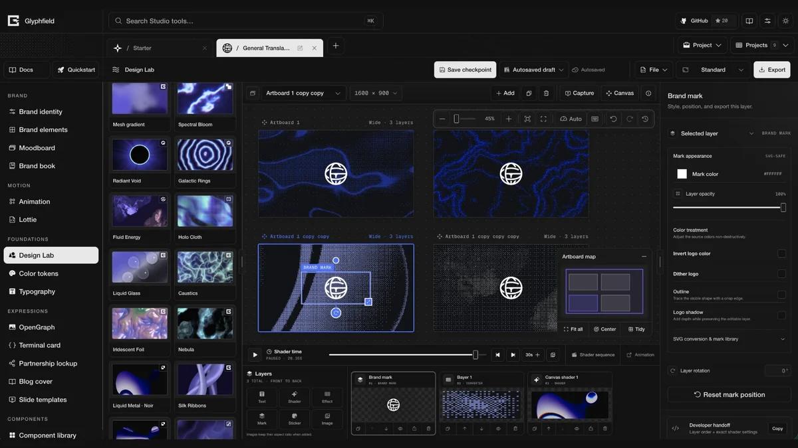
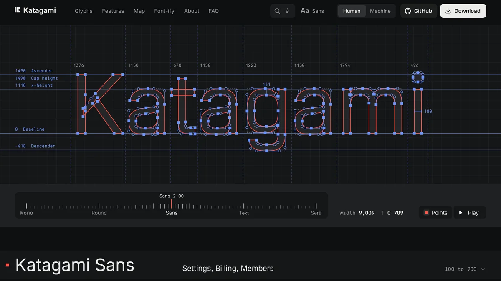

<table width="100%">
  <tr>
    <td valign="middle">
      <a href="https://x.com/kevskgs" title="X"><picture><source media="(prefers-color-scheme: dark)" srcset="https://cdn.simpleicons.org/x/ffffff"></picture></a>
      
      <b>Lift, ship, and draw</b>
    </td>
  </tr>
  <tr>
    <td align="center">
      
      
       
      
      
    </td>
  </tr>
  <tr>
    <td>
      <b>languages</b> 
      
      
      
      
      
      
    </td>
  </tr>
  <tr>
    <td>
      <b>frontend</b> 
      
      
      
      
      
      
      
    </td>
  </tr>
  <tr>
    <td>
      <b>agents / ai</b> 
      
      
      
      
      
      
      
    </td>
  </tr>
  <tr>
    <td>
      <b>infra</b> 
      
      
      
      
      
      
      
    </td>
  </tr>
</table>
